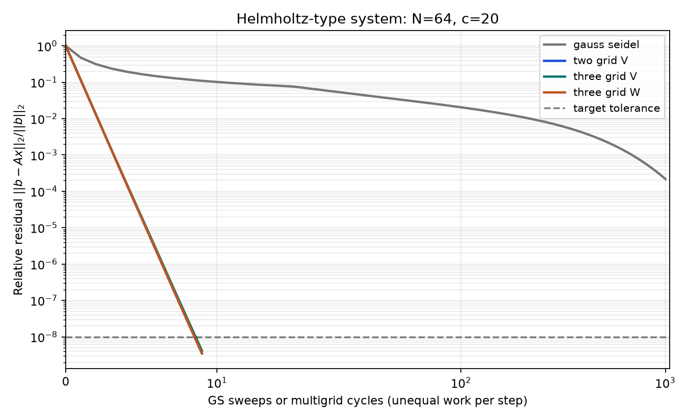
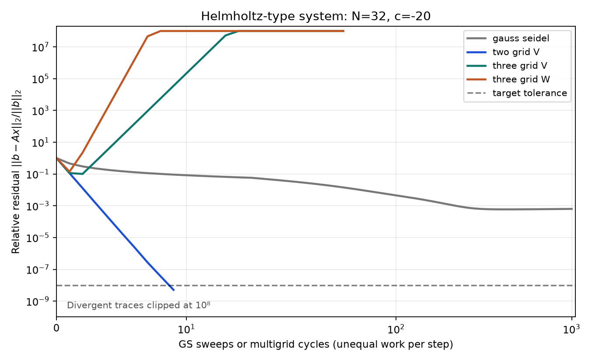
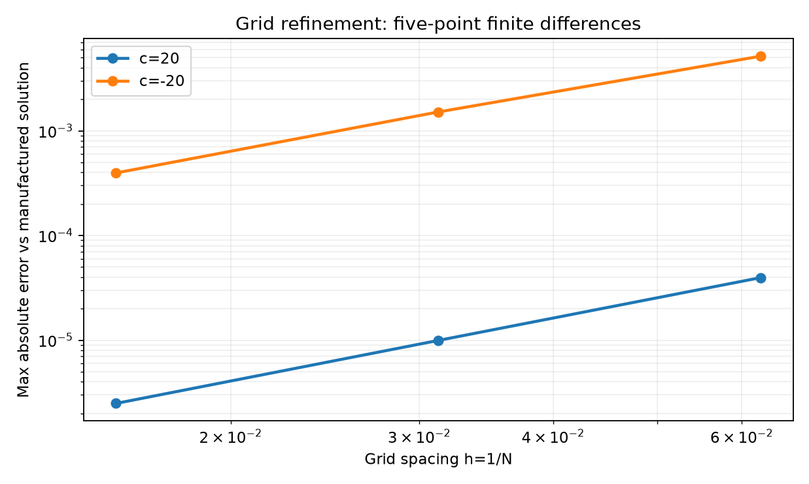

# Multigrid Methods for 2D Helmholtz Equations

**Finite differences · sparse linear algebra · Gauss–Seidel · two-grid correction · three-grid V/W-cycles**

A self contained Python project comparing classical iterative solvers and
multigrid cycles for the manufactured two dimensional **Helmholtz-type
reaction–diffusion equation**

$$
-\Delta u + c u=f \quad \text{on }(0,1)^2,
\qquad u|_{\partial\Omega}=u_\mathrm{exact},
$$

with exact solution

$$
u_\mathrm{exact}(x,y)=x(1-x)y^3(1-y)+e^x.
$$

The experiments investigate both **$c=20$** (positive definite) and
**$c=-20$** (indefinite, close to the first Dirichlet eigenvalue). The project
is based on the numerical methods and problem explored in an MSc scientific
computing MATLAB coursework assignment at TU Delft; the implementation here
is a separately tested Python version.



## What is implemented?

- **Manufactured problem:** analytic forcing and exact Dirichlet boundary data.
- **Five point finite differences:** symmetric sparse matrix for the
  $(N-1)^2$ interior unknowns; Dirichlet contributions incorporated in the RHS.
- **Direct reference:** SciPy sparse direct solve to distinguish solver error
  from spatial discretisation error.
- **Forward Gauss–Seidel:** a sparse triangular sweep, without forming a dense
  inverse or iteration matrix.
- **Two-grid V-cycle:** bilinear interpolation, full weighting restriction,
  Galerkin coarse operator, one pre/post GS sweep and an exact coarse solve.
- **Three-grid V/W-cycles:** reusable recursive hierarchy; W-cycles revisit
  the coarse level twice and the coarsest system uses sparse LU.
- **Automated tests:** manufactured solution consistency, grid refinement,
  transfer operators, solver accuracy and representative indefinite cases.

## Verified numerical results

The table shows the number of GS **sweeps** or multigrid **cycles** required to
achieve relative residual $\|b-Ax\|_2/\|b\|_2 < 10^{-8}$. Multigrid cycles
have a higher per iteration cost than individual GS sweeps; these counts
must **not** be interpreted as runtime speedups.

### $c=20$: positive definite case

| Number of grid intervals per axis | Gauss–Seidel | Two-grid V | Three-grid V | Three-grid W |
|---:|---:|---:|---:|---:|
| 16 | 219 sweeps | 9 cycles | 9 cycles | 9 cycles |
| 32 | 820 sweeps | 9 cycles | 9 cycles | 9 cycles |
| 64 | Not reached after 1,000 sweeps | 9 cycles | 9 cycles | 9 cycles |

For this example, the multigrid cycle count stays approximately constant as
the grid is refined, while Gauss–Seidel slows markedly.

### $c=-20$: indefinite near resonance case

| Grid | Two-grid V | Three-grid V | Three-grid W |
|---:|---|---|---|
| 16 | Does not converge | Does not converge | Does not converge |
| 32 | 9 cycles | Does not converge | Does not converge |
| 64 | 9 cycles | 11 cycles | 9 cycles |

Failures refer to this particular transfer/smoother/coarsening strategy and
iteration limits, **not** to multigrid methods in general. The three grid
hierarchies at $N=16$ and $N=32$ include problematic coarse operators; see the
[spectral discussion](docs/numerics.md#why-the-negative-reaction-coefficient-matters).



### Krylov acceleration for the indefinite case

An additional [GMRES experiment](docs/krylov.md) investigates the
indefinite problem with `c=-20`.

The method applies restarted GMRES to the original indefinite system,
using one zero initialized multigrid V-cycle of an auxiliary
positive definite operator as a fixed preconditioner:

- Original operator: `A = -Delta_h - 20I`
- Auxiliary operator: `P = -Delta_h + 20I`
- Preconditioner: one V-cycle approximating the inverse of `P`

The true relative residual is evaluated against the original system.

| Grid | Standalone three-grid V-cycle | GMRES alone | Shifted-MG-preconditioned GMRES |
|---:|---|---|---|
| 16 | Not converged | 105 Arnoldi steps | **17 Arnoldi steps** |
| 32 | Not converged | Not converged | **17 Arnoldi steps** |
| 64 | 11 cycles | Not converged | **17 Arnoldi steps** |

All successful solves reached a true relative residual below `1e-8`.

These comparisons use fixed iteration budgets. A multigrid cycle and
a GMRES iteration have different computational costs, so the counts
do not establish runtime speedups or general grid independent convergence.

Reproduce the experiment:

```bash
python experiments/gmres_indefinite.py --grids 16 32 64
```

The new implementation is in
[`src/multigrid_helmholtz/krylov.py`](src/multigrid_helmholtz/krylov.py),
with independent numerical tests in
[`tests/test_krylov.py`](tests/test_krylov.py).

### Accuracy against the exact solution

For the **sparse direct reference** at $c=20$, the maximum absolute errors are:

| Grid | $\|u_h-u_\mathrm{exact}\|_\infty$ |
|---:|---:|
| 16 | 3.961 × 10⁻⁵ |
| 32 | 9.950 × 10⁻⁶ |
| 64 | 2.488 × 10⁻⁶ |

The observed error decreases by about a factor of four when $h$ is halved,
consistent with the second order five point finite difference stencil.



All displayed results were computed from the Python implementation with
`numpy`, `scipy`, and `pytest` tests. 

## Quick start

Requirements: **Python 3.10+**, NumPy, SciPy, Matplotlib (for figures), pytest
(for tests).

```bash
python3 -m venv .venv
source .venv/bin/activate
python -m pip install -e '.[all]'
python -m pytest -q
python experiments/run_all.py
```

`experiments/run_all.py` regenerates the plots under `figures/` and writes
`results/solver_results.csv` (ignored by Git, to avoid stale generated output).
Its default settings are `--grids 16 32 64 --coefficients 20 -20`, tolerance
`1e-8`, and caps of 1,000 GS sweeps / 50 multigrid cycles.

For a different experiment:

```bash
python experiments/run_all.py --grids 16 32 64 128 --coefficients 20 --gs-max 2000
python experiments/spectrum.py --grids 16 32 64 --coefficients -20
```

The second command writes `results/spectrum.csv` and displays how the lowest
eigenvalue changes across the Galerkin grid hierarchy.

**Timing caveat:** the experiment script measures exploratory single run times
but does not provide controlled strong scaling or speedup benchmarks. Future
CPU benchmarks should use repeated runs, hardware details and equivalent
accuracy targets.

## Repository structure

```text
src/multigrid_helmholtz/
    problem.py          Analytic solution and forcing
    discretization.py   Sparse five point operator and Dirichlet RHS
    transfer.py         Bilinear prolongation and full weighting restriction
    solvers.py          Sparse direct, Gauss–Seidel, two-/three-grid V/W-cycles
experiments/
    run_all.py          Residual histories and grid refinement plots
    spectrum.py         Eigenvalues of the fine and Galerkin coarse operators
tests/                  Automated numerical verification
figures/                Reproducible numerical figures
validation/             Example solver and spectrum results (no timing claims)
docs/numerics.md        Derivations, implementation decisions, limitations
.github/workflows/      CPU numerical tests on GitHub Actions
```

## Interpretation and limitations

The five point discretisation is second order on this smooth manufactured
problem. The `$c=-20$` operator is **not positive definite**, and simple
Gauss–Seidel/Galerkin multigrid are not guaranteed to converge, especially
near a coarse grid resonance. More robust indefinite Helmholtz methods could
use different smoothers, shifted operators, special coarse spaces, or Krylov
acceleration. The numerical and spectral experiments are pedagogical rather
than claims of a generally optimal solver.

See [numerical methodology](docs/numerics.md) for the equations, transfer
operators, tests and interpretation of convergence metrics.

## Project context

Developed from the mathematical problem and algorithm comparisons in
scientific computing coursework completed during the MSc Applied Mathematics
programme at **Delft University of Technology (TU Delft)**. 
